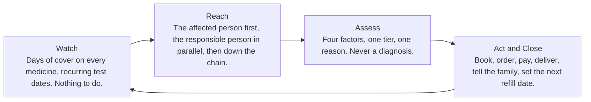
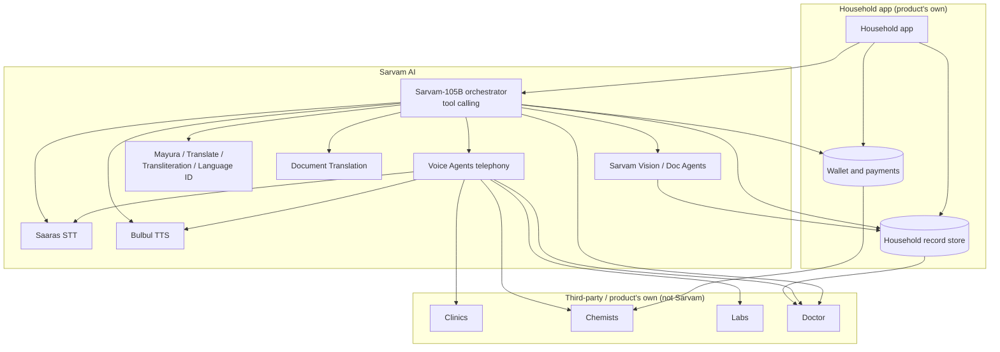

# Family Health Agent

Parents' medicines, appointments and reports — handled, without anyone having to remember.

## Summary

Families managing an aging parent's health across two cities do the work by hand: one adult child tracks the medicines, books the clinic, orders the refills and answers the doctor, and nobody can see how many days of a daily medicine are actually left. The Family Health Agent is one app for a household, with an agent inside it that treats the family's health as a standing responsibility rather than a series of errands. One person sets it up in a single sitting — installs the app, adds the others, photographs a prescription and sets a spending limit — and from then on the agent watches the supply of every medicine, calls the clinic and sits through the hold, orders and pays within a limit the family sets, and tells everyone what happened, speaking to each person in their own language. It is built on Sarvam AI's Indic speech, language, document and voice-agent stack, so the parent who speaks a language other than English, the clinic reached by phone rather than by app, and the voice notes that arrive in whatever language the family uses are first-class inputs rather than edge cases.

## The problem

The core insight is one line: "Nobody finds out the medicine is over until it is over."

In a survey of 25 people across 10 Indian families in September 2026, 21 had someone at home on a lifelong daily medicine. 23 of them found out a medicine was finished by counting what was left in the strip, or on the day it ran out. Only 2 had ever had a doctor's visit that began because a refill was due. The supply of a medicine that must not be missed is tracked by eye, by one person, usually from another city.

That person is almost always an adult child. 12 of the 25 said their parent no longer phones the clinic at all: a child books the slot, orders the medicines and answers the doctor's questions on their behalf. But of the parents in the sample, 5 of 9 said they still want to be asked first. They had given up the errands, not the choices. A respondent named the second cost: history gets lost when someone new is handling it.

The scale behind this is not in dispute. India's elderly share of population is projected to pass 20% by 2050, growing about 41% a decade, with the 80-and-over group growing roughly 279% between 2022 and 2050 (UNFPA, India Ageing Report 2023). About one in four Indian adults has hypertension and only around 12% have it under control (WHO India). Households carry much of the cost themselves: out-of-pocket spending was 49.9% of current health expenditure in the 2022-23 National Health Accounts.

The work is real, recurring, and lands on a family member with no tools for it. What exists today sells either hands (nurses, attendants, emergency response) or delivery (pharmacy apps). Nothing sells the coordination.

The one child who keeps track becomes the single point of failure, and the parent, having handed over the errands, slowly loses the decisions with them.

## Who it is for

The first segment is a pair of cities, not a city. The payer is an adult child between 25 and 40, salaried, living in a Tier 1 city. The parent is 60 or over, in a Tier 2 city or smaller, on at least one daily medicine, using WhatsApp on a smartphone, and speaking a language other than English at home. A son in Hyderabad and a mother in Warangal is the shape of it.

That pairing is chosen over the two obvious alternatives. Metro to metro is too close: the child can drive over on a Saturday, so the problem resolves itself badly but it resolves. Non-resident children pay more and are the natural second market, but they are already served by staffed operators, and buying hands is a reasonable answer when you are eight time zones away. The Tier 1 to Tier 2 pair is where the distance is too far to drive and too near to justify hiring someone, where the clinic and the chemist are small, local and reached by phone rather than by app, and where the parent's language is the first thing most products get wrong.

Growth follows the same logic: one city pair at a time, because the clinics and chemists have to be known for the agent to be useful, and that knowledge is local.

## What it is

One app for a household, with an agent inside it that treats the family's health as a standing responsibility rather than a series of errands. One person sets it up: installs it, adds the others, photographs a prescription, and sets a spending limit. That is the whole of onboarding, and it happens in one sitting.

### The four roles

Four roles shape every decision the agent makes.

The **affected person** is whoever needs care.

The **responsible person** owns the wallet and holds a veto, used only when they and the affected person disagree.

The **contact chain** is ranked by who can make a sound decision, not by age.

The **family group** sees that something happened, never the medical detail, which goes only to the responsible person and the doctor.

### What it takes in

One prescription photo, the known conditions and current medicines, a ranked contact chain, each person's preferred language, a wallet limit, and the figure above which it must ask before spending. After that: voice notes and messages from the family in whatever language they use, and its own clock reaching a refill or test date.

### What it gives back

A real days-left figure per medicine, counted from what was actually dispensed. A clinic slot booked and confirmed by name, with the parent on the line. Medicine ordered, paid within the limit and delivered to a named recipient. Status to the family group and full detail with every rupee to the responsible person. One assembled record for the doctor, covering summary, last reports, current medicines and the trend.

### What it will not do

Three things it will not do, by design: it never names a condition, never suggests a dose, and never substitutes a medicine. Each of those goes to a human.

## How it works

Ten stages, which fold into four phases.

### The loop

The loop runs Watch, Reach, Assess, Act and Close, and then returns to Watch.



### Triggers

Something starts the loop in one of three ways, and only those three: the affected person sends a voice note or message, another family member raises it, or the agent's own clock reaches a date its data produced.

Each kind of trigger spans a range of severity. A medication trigger can be a finished antibiotic course or a blood-pressure tablet with no stock nearby. A test can be a one-off swab or a panel a doctor wants within hours. An emergency can be a mild flu or an ambulance.

### How severity is assessed

Severity is worked out, not tagged. At the assessing stage the agent weighs four things: whether what was said matches the family's **red-flag list**, whether it is new or worsening for this person, whether it touches a medicine they already take, and the context of time, distance, who is reachable and money left. It cites which of the four it used and gives one line of reasoning. The result is one **tier**. If the factors disagree, or it cannot tell, it goes up a tier and asks a human. It never guesses downward.

### The ten stages and their failure modes

| Stage | What it does | When it breaks |
|---|---|---|
| Onboarding | Family, conditions, medicines, red flags, two clinics, chemists and labs each, languages, wallet limit, consent per adult. | — |
| Idle | Watch days of cover and recurring test dates. | — |
| Triggered | Tags the kind of trigger and a first severity, with the source named. | Nobody answers the trigger: it moves to the next contact rather than waiting. |
| Reaching | Call the affected person, tell the responsible person at the same time. | No answer: works down the ranked chain. On a critical tier it calls the person and the responsible person together. |
| Listening | Keeps what was said word for word, in their language, and writes a separate short summary. | The person cannot describe it: whoever is present speaks, and the account is marked **secondhand** for the doctor. |
| Assessing | Follow-up questions against known conditions and medicines, then a tier with its reasons. | Cannot tell: treats it as urgent and asks a human. Critical with nobody reachable: dispatches anyway and keeps calling. |
| Acting | Book the slot, order the medicine, arrange transport, and pay from the wallet. | The clinic will not answer: redials, tries the second clinic, then reports the dead end. No slot: takes the next option and says which and why. Out of stock: next chemist, never a substitute. |
| Checking in | Runs alongside the rest. Status to the family group, spend and detail to the responsible person. | Spend above the limit: stops and asks. No answer: holds the booking unpaid rather than cancelling it. |
| Handing over | Send the doctor one record: summary, last reports, current medicines, the trend. | Wrong specialist: carries the same record into the new booking. |
| Closing | Slot confirmed by name, medicine received by a named person, family told who did what, next refill date set. | — |

Every failure moves to the next option, holds, or hands back to a human, and none of them stops silently.

### The core mechanic: counting from what was dispensed

The loop closes on what was dispensed, not what was prescribed, and that is the single most important mechanic in the product. People routinely buy only what the week's cash covers. Twenty tablets handed over at two a day is ten days of cover, where the sixty on the prescription would have implied thirty. A clock set from the prescription runs out twenty days late, which is the worst direction to be wrong in, because the family believes there is cover when there is none. The agent therefore reads the **dispensed quantity** off the counter, not the paper, and records where its number came from — the receipt image, the extracted value, its confidence, and who confirmed it. The resulting **days of cover** is the number the whole loop runs on.

### The phone call, not the room

The agent calls the clinic, waits on hold, and hands the parent the line when a person answers. The parent confirms their own appointment in their own language. The child loses the logistics without the parent losing the choice.

## (Proposed) Built on Sarvam AI

The sources describe the product and its behaviour. This section describes how the product is built on Sarvam AI. Everything here that the sources do not state is marked **(Proposed)**.

### Why Sarvam

The product's hardest inputs are the ones most software treats as edge cases. The parent speaks a language other than English at home. The clinic and the chemist in a smaller city are reached by phone, not by app, so the agent has to place a real call, wait on hold and speak. Voice notes arrive from the family in whatever language they use. Code-mixed speech — Hindi carrying English words, or a prescription read out in two languages in one sentence — is normal in this setting, not unusual.

Sarvam AI matches that shape. Its speech and document models cover 22 Indian languages plus English, and its speech recognition handles code-mixed speech. Its voice agents run on telephony, so the agent can place and receive real calls. Its speech recognition, reasoning and synthesis are self-hosted by Sarvam, and data including PII stays in India, which matters for a product that holds prescriptions, reports and family medical history.

### Stage-to-component map

| Stage | Sarvam component | What it does here | Key setting or limit |
|---|---|---|---|
| Onboarding | Sarvam Vision through Doc Agents **Extract**; Language Identification | Read the prescription photo into structured fields; set each person's preferred language | Prescriptions are a listed document type; PDF, JPEG, PNG, up to 50 MB and 10 pages per project; each field returns a confidence score; low-confidence fields go to the responsible person, never auto-filled; save the schema as a reusable Config (12 templates) |
| Idle | Product's own clock (no Sarvam service) | Count days of cover and hold recurring test dates | The clock is the product's own data; no Sarvam component runs while idle |
| Triggered | Saaras; Voice Agents instant outbound call; Sarvam-105B | Read an incoming voice note or message and tag the kind of trigger with a first severity | Saaras accepts OGG and OPUS (WhatsApp voice notes) and AMR; verbatim and codemix modes; instant outbound calls can be placed through the Voice Agents API |
| Reaching | Voice Agents (outbound calls) | Call the affected person and tell the responsible person at the same time, then work down the ranked chain | Calls can last up to 60 minutes; on a critical tier the person and the responsible person are called together |
| Listening | Saaras (verbatim, codemix, diarization, translate) | Keep the person's words exactly, in their language, and write a separate short English summary | Verbatim mode keeps the exact words; codemix mode for mixed speech; batch diarization separates speakers to mark a secondhand account; translate mode produces the summary; keyterm prompting up to 50 terms on v4, REST and batch only |
| Assessing | Sarvam-105B with `tools` and `response_format` json_schema | Ask follow-up questions against known conditions and medicines, weigh the four factors, and produce one tier with one reason | 128K context; reasoning on by default; do not set a small `max_tokens` while reasoning is on; `json_schema` with `strict`; severity only escalates |
| Acting | Voice Agents (API tools, call transfer, knowledge base) | Call the clinic, wait on hold, hand the parent the line, book the slot, order the medicine, and pay within the limit | API tools call booking and ordering systems; call transfer carries the hand-off; a knowledge base per household holds the clinic and chemist list; calls up to 60 minutes cover hold times. Payments and the chemist and clinic directories are the product's own or third-party systems, not Sarvam |
| Checking in | Mayura / Sarvam Translate; Bulbul TTS | Send status to the family group and full detail with every rupee to the responsible person | Mayura covers 11 languages; Bulbul v4 Flash speaks 10; set `pace` between 0.5 and 2.0; REST takes 2,500 characters per request |
| Handing over | Sarvam-105B; Doc Agents **Digitise**; Document Translation | Assemble the doctor record (summary, last reports, current medicines, the trend); translate reports for a doctor or family member in another language | Digitise exports HTML, Markdown, DOCX or TXT; Document Translation preserves layout and format, up to 12 target languages per job |
| Closing | Bulbul TTS; Sarvam-105B | Confirm the slot by name, confirm the medicine received by a named person, tell the family who did what, and set the next refill date from the dispensed quantity | The next refill date is computed by the product's own logic from the dispensed quantity; the agent records and speaks it |

### Component deep-dives

#### Saaras (speech to text)

Saaras turns every spoken input into text. Its default is v4, with v3 still available, and it covers 22 Indian languages plus English. It accepts most audio formats, including OGG and OPUS (which is what WhatsApp voice notes are) and AMR, so a voice note from the family arrives without conversion.

The mode matters and differs by job. **Verbatim** mode is used for the listening stage, because the product keeps the person's exact words — fillers and spoken numbers as said — and marks a secondhand account when someone else speaks for the affected person. **Codemix** mode is used when the family mixes English words into an Indic sentence. **Translate** mode produces the English summary for the doctor. **Translit** mode produces Roman-script text for a family member who reads their language in Latin letters.

The limits shape the design. REST takes up to 30 seconds per request, so a long voice note is handled through batch, which takes up to 2 hours per file, or through streaming over WebSocket. Diarization is batch only, which is acceptable because speaker separation for a secondhand account is not latency-critical. Keyterm prompting takes up to 50 terms on v4, REST and batch only, and is loaded with the household's medicine names so a drug name is not misheard as an ordinary word. Language detection returns `language_probability` when the language is left unknown, which is used to set a speaker's preferred language at onboarding.

#### Bulbul (text to speech)

Bulbul speaks the agent's replies and its status messages. Bulbul v4 Flash covers Hindi, English, Hinglish, Bengali, Gujarati, Kannada, Marathi, Punjabi, Tamil and Telugu, with 200+ persona voices. Malayalam and Odia are on v3 only, and v3 reaches end of life on Voice Agents on 10 November 2026, so the build targets v4 Flash.

Two settings matter. `pace` runs from 0.5 to 2.0 and is set slower for elderly listeners, who are the audience for every spoken message. Indic text is written in native script, not romanised, because romanised Indic input is not the intended form. There is no SSML, so emphasis and pauses cannot be marked in the text; the voice and pace carry them. REST takes 2,500 characters per request, which is well above the length of a status or confirmation message. The MCP server's pronunciation dictionary management is used so medicine and clinic names are said correctly rather than read as spelling.

#### Sarvam-105B (reasoning and orchestration)

`sarvam-105b` is the orchestrator for everything that is not a live call. It has a 128K context and reasoning on by default. It runs the assessing stage, assembles the doctor record, and calls the tools. It covers the top 10 Indian languages plus English, in native script, romanised and code-mixed input.

Three parameters carry the product's rules into the model. `tools` with `type: "function"` and `tool_choice` let the model call only the tools the product defines, so it cannot invent a diagnostic or a dosing action. `response_format` of type `json_schema` with `strict` forces the assessment into a fixed shape, so a tier, a factor list and a reason are always present and always structured. `reasoning_effort` is set for the assess stage, and `max_tokens` is kept well clear of the reasoning budget, because reasoning tokens count toward `max_tokens` and a small cap would truncate the answer.

`sarvam-105b-conversations` is the real-time variant, with a 32K context, and runs the live-call dialogue inside the voice agent.

#### Sarvam Vision and Doc Agents

Sarvam Vision is the document intelligence layer: OCR and structured output across 23 languages. Doc Agents **Extract** turns plain-English field descriptions into an editable schema and returns a value, a confidence score and a not-found placeholder per field, with inline correction. It is used twice, and the second use is the technical heart of the core mechanic.

Onboarding: a schema for medicine name, strength, frequency, duration, prescriber and date is run over the prescription photo. Prescriptions are a listed document type. Low-confidence fields go to the responsible person to confirm and are never auto-filled. The schema is saved as a reusable Config.

Dispensed quantity: the same Extract runs over the itemised chemist receipt, which is also a listed type, to read the quantity actually handed over. The extracted quantity is stored with its provenance — receipt image, extracted value, confidence, and who confirmed it — and feeds the days-of-cover calculation.

Doc Agents **Digitise** handles old handwritten reports, scans, tables and multilingual documents, exporting HTML, Markdown, DOCX or TXT into the household record. Accepts PDF, JPEG and PNG, up to 50 MB and 10 pages per project.

#### Mayura, Sarvam Translate, transliteration and language identification

Mayura and Sarvam Translate render short text between languages, used for family-group and responsible-person messages so each member reads in their own language. Transliteration serves a member who reads their language in Roman script. Language Identification sets a speaker's preferred language at onboarding, and Saaras also returns `language_probability` when the language is left as unknown. Mayura covers 11 languages (10 Indian plus English).

#### Document Translation

Document Translation translates PDF and Office files into up to 12 Indian languages per job, preserving layout and format. It carries the doctor record and the reports to a doctor in another state or a family member who reads another language, without losing the layout of a lab report.

#### Voice Agents platform

Voice Agents run inbound and outbound phone calls in a real-time speech-to-text, LLM and text-to-speech loop. They work with Sarvam or rented numbers, or with the family's own provider, including Exotel, Twilio, Smartflo, Plivo, Vobiz, Pulse and Intalk. Channels include telephony, a web voice and chat widget, API, and SDKs for Python, Web, React Native and Flutter. WhatsApp text and voice are enterprise, on request, and not generally available.

The platform carries most of the acting and reaching stages. **API tools** call booking and ordering systems. **Call transfer** performs the hand-off, both to the parent when a clinic answers and to a human when the agent escalates. **Multi-state agents** run the stage flow. **On-start and on-end hooks** write to the record store. A **knowledge base** per household holds its clinic and chemist list. **Campaigns**, with cohorts, dialing rate, concurrency and DND handling, run scheduled refill and test calls. **Instant outbound calls** through the API start a triggered episode. Calls can last up to 60 minutes, which covers clinic hold times. Agent Analytics, call logs and the log analyser serve as the audit trail. Speech recognition, reasoning and synthesis are self-hosted by Sarvam, and data including PII stays in India.

#### MCP server and SDKs

The Sarvam MCP server (`sarvam_tools_*` for runtime tasks including speech-to-text, text-to-speech, translation, transliteration, language ID, chat, document extraction and digitisation, and pronunciation dictionary management; `sarvam_code_*` for docs and starter code) and the official `sarvamai` Python and JS/TS SDKs are how the product is built and operated. Framework integrations include LiveKit, Pipecat, Vapi, Twilio, Exotel, LangChain, Vercel AI SDK and n8n. Self-hosted deployment is available.

#### Not used

Dubbing, Content Studio and the coding agent are not relevant to this product and are not included. Instant Voice Cloning is deliberately excluded by default: a cloned family voice calling a parent conflicts with the product's principle of keeping the parent in the decision, and could mislead.

### Language coverage

The columns below are filled only from SOURCE C. Where the source states coverage, the language is marked yes; where it does not, the cell is marked no.

| Language | Saaras (hear) | Bulbul v4 Flash (speak) | Voice Agents (live call) | Text and document models |
|---|---|---|---|---|
| Hindi | Yes | Yes | Yes | Yes |
| Bengali | Yes | Yes | Yes | Yes |
| Tamil | Yes | Yes | Yes | Yes |
| Telugu | Yes | Yes | Yes | Yes |
| Marathi | Yes | Yes | Yes | Yes |
| Gujarati | Yes | Yes | Yes | Yes |
| Kannada | Yes | Yes | Yes | Yes |
| Malayalam | Yes | No | Yes | Yes |
| Punjabi | Yes | Yes | Yes | Yes |
| Odia | Yes | No | Yes | Yes |
| Assamese | Yes | No | Yes | Yes |
| Urdu | Yes | No | No | Yes |
| Nepali | Yes | No | No | Yes |
| Konkani | Yes | No | No | Yes |
| Kashmiri | Yes | No | No | Yes |
| Sindhi | Yes | No | No | Yes |
| Sanskrit | Yes | No | No | Yes |
| Santali | Yes | No | No | Yes |
| Manipuri (Meitei) | Yes | No | No | Yes |
| Bodo | Yes | No | No | Yes |
| Maithili | Yes | No | No | Yes |
| Dogri | Yes | No | No | Yes |
| English | Yes | Yes | Yes | Yes |

SOURCE C publishes the text and document models as coverage counts, not enumerated lists: Sarvam Vision reads 23 languages, Mayura translates 11, and Document Translation renders up to 12 Indian languages per job. The last column marks reading support at that stated breadth; translation is narrower than reading, so a document may be read in a language it cannot be translated into. The per-language lists for these models are not published in the source.

The design consequence is plain: some languages can be heard and read but not yet spoken back or handled on a live call. Saaras hears all 22 Indian languages plus English, but Bulbul v4 Flash speaks 10 and Voice Agents runs live calls in 12. Malayalam and Odia are heard and are on the Voice Agents list, but Bulbul v4 Flash does not speak them — they are on v3 only, and v3 reaches end of life on Voice Agents on 10 November 2026. Assamese is heard and is on the Voice Agents list but is not spoken by v4 Flash. Urdu, Nepali, Konkani, Kashmiri, Sindhi, Sanskrit, Santali, Manipuri (Meitei), Bodo, Maithili and Dogri are heard but are on neither the Bulbul v4 Flash list nor the Voice Agents list.

**(Proposed)** Where a language can be heard but not spoken back or carried on a live call, the agent sends its message as text in the person's own language through Mayura or Sarvam Translate, and places any live call in the person's second language. Where neither is possible, or the family prefers it, the agent hands the episode to a family member on the contact chain who speaks a covered language rather than attempt the call itself. In every case the refusal rules hold: no call, in any language, names a condition, suggests a dose or substitutes a medicine.

### System architecture

The household app, the agent orchestrator and the Sarvam components are shown below. Payments, the record store and the chemist and clinic directories are the product's own or third-party systems, not Sarvam services.



### Agent tools

The orchestrator calls only the tools below. Every tool derives from a behaviour the sources state. There is no tool that diagnoses, doses or substitutes; those actions have no function and cannot be reached by the model.

```json
{
  "tools": [
    {
      "type": "function",
      "function": {
        "name": "get_days_of_cover",
        "description": "Return days of cover per medicine, counted from the quantity actually dispensed, with the provenance of the number.",
        "parameters": {
          "type": "object",
          "properties": {
            "medicine_id": { "type": "string" },
            "dispensed_quantity": { "type": "number" },
            "dose_per_day": { "type": "number" },
            "provenance_ref": { "type": "string" }
          },
          "required": ["medicine_id"]
        }
      }
    },
    {
      "type": "function",
      "function": {
        "name": "place_call",
        "description": "Place an outbound phone call to a clinic, chemist or lab and wait on hold.",
        "parameters": {
          "type": "object",
          "properties": {
            "party_type": { "type": "string", "enum": ["clinic", "chemist", "lab"] },
            "party_id": { "type": "string" },
            "language": { "type": "string" },
            "purpose": { "type": "string" }
          },
          "required": ["party_type", "party_id", "purpose"]
        }
      }
    },
    {
      "type": "function",
      "function": {
        "name": "transfer_call_to_affected_person",
        "description": "Hand the live call to the affected person when a person answers, so the parent confirms in their own language.",
        "parameters": {
          "type": "object",
          "properties": {
            "call_id": { "type": "string" },
            "affected_person_id": { "type": "string" }
          },
          "required": ["call_id", "affected_person_id"]
        }
      }
    },
    {
      "type": "function",
      "function": {
        "name": "book_slot",
        "description": "Book a clinic slot and return the confirmed slot with the name on it.",
        "parameters": {
          "type": "object",
          "properties": {
            "clinic_id": { "type": "string" },
            "affected_person_id": { "type": "string" },
            "slot": { "type": "string" }
          },
          "required": ["clinic_id", "affected_person_id", "slot"]
        }
      }
    },
    {
      "type": "function",
      "function": {
        "name": "order_medicine",
        "description": "Order a medicine from the next chemist. Never substitutes a medicine.",
        "parameters": {
          "type": "object",
          "properties": {
            "chemist_id": { "type": "string" },
            "medicine_id": { "type": "string" },
            "quantity": { "type": "number" },
            "recipient_id": { "type": "string" }
          },
          "required": ["chemist_id", "medicine_id", "quantity"]
        }
      }
    },
    {
      "type": "function",
      "function": {
        "name": "pay_from_wallet",
        "description": "Pay from the household wallet. Refuses above the ask-above figure and returns needs_approval instead of paying.",
        "parameters": {
          "type": "object",
          "properties": {
            "order_id": { "type": "string" },
            "amount_inr": { "type": "number" }
          },
          "required": ["order_id", "amount_inr"]
        }
      }
    },
    {
      "type": "function",
      "function": {
        "name": "notify_family_group",
        "description": "Send status only to the family group. Never the medical detail.",
        "parameters": {
          "type": "object",
          "properties": {
            "family_group_id": { "type": "string" },
            "status": { "type": "string" },
            "who_did_what": { "type": "string" }
          },
          "required": ["family_group_id", "status"]
        }
      }
    },
    {
      "type": "function",
      "function": {
        "name": "notify_responsible_person",
        "description": "Send full detail, including every rupee, to the responsible person.",
        "parameters": {
          "type": "object",
          "properties": {
            "responsible_person_id": { "type": "string" },
            "detail": { "type": "string" },
            "amounts_inr": { "type": "array", "items": { "type": "number" } }
          },
          "required": ["responsible_person_id", "detail"]
        }
      }
    },
    {
      "type": "function",
      "function": {
        "name": "build_doctor_record",
        "description": "Assemble one record for the doctor: summary, last reports, current medicines and the trend.",
        "parameters": {
          "type": "object",
          "properties": {
            "affected_person_id": { "type": "string" },
            "summary": { "type": "string" },
            "report_refs": { "type": "array", "items": { "type": "string" } },
            "current_medicines": { "type": "array", "items": { "type": "string" } },
            "trend": { "type": "string" }
          },
          "required": ["affected_person_id", "summary"]
        }
      }
    },
    {
      "type": "function",
      "function": {
        "name": "set_next_refill_date",
        "description": "Set the next refill date from the dispensed quantity, so the loop restarts on its own.",
        "parameters": {
          "type": "object",
          "properties": {
            "medicine_id": { "type": "string" },
            "days_of_cover": { "type": "number" }
          },
          "required": ["medicine_id", "days_of_cover"]
        }
      }
    },
    {
      "type": "function",
      "function": {
        "name": "escalate_to_human",
        "description": "Hand the episode to a human when the factors disagree or the agent cannot tell. Severity only escalates.",
        "parameters": {
          "type": "object",
          "properties": {
            "episode_id": { "type": "string" },
            "reason": { "type": "string" },
            "tier": { "type": "string" }
          },
          "required": ["episode_id", "reason"]
        }
      }
    }
  ]
}
```

`pay_from_wallet` is the tool that enforces the wallet rule: above the ask-above figure it does not pay and returns `needs_approval`, so the responsible person decides. `notify_family_group` carries status only, and `notify_responsible_person` carries the full detail and every rupee. No tool names a condition, suggests a dose or substitutes a medicine, and none is provided, so the three refusals cannot be broken through tool use.

### Assessment output schema

The assessing stage runs with a `response_format` of type `json_schema` and `strict: true`, so the model returns exactly this shape or nothing.

```json
{
  "response_format": {
    "type": "json_schema",
    "json_schema": {
      "name": "assessment",
      "strict": true,
      "schema": {
        "type": "object",
        "properties": {
          "trigger_kind": {
            "type": "string",
            "enum": ["affected_person", "family_member", "agent_clock"]
          },
          "source": { "type": "string" },
          "tier": {
            "type": "string",
            "enum": ["routine", "elevated", "urgent", "critical"]
          },
          "factors_used": {
            "type": "array",
            "items": {
              "type": "string",
              "enum": [
                "matches_red_flag_list",
                "new_or_worsening",
                "touches_existing_medicine",
                "context_time_distance_reachability_money"
              ]
            }
          },
          "reason": { "type": "string" },
          "escalated": { "type": "boolean" },
          "account_type": {
            "type": "string",
            "enum": ["firsthand", "secondhand"]
          },
          "verbatim_transcript_ref": { "type": "string" },
          "summary": { "type": "string" }
        },
        "required": [
          "trigger_kind",
          "source",
          "tier",
          "factors_used",
          "reason",
          "escalated",
          "account_type",
          "verbatim_transcript_ref",
          "summary"
        ],
        "additionalProperties": false
      }
    }
  }
}
```

The tier values are the four steps of the severity scale, and the factor list is limited to the four factors, so the model cannot cite a factor the product does not use. A validation step runs before the output is accepted: any output whose `reason` or `summary` contains a condition name, a dose, or a substitute suggestion is rejected, and the episode is escalated to a human instead. `account_type` carries secondhand when someone else spoke for the affected person, and `verbatim_transcript_ref` points to the person's exact words, which are stored separately from the summary.

### System prompt skeleton for the live-call agent

The live call runs on `sarvam-105b-conversations` with a system prompt of this shape.

```
You are the Family Health Agent, speaking on a live phone call for one household.

ROLE
You keep the household's medicines, appointments and records running. You are on a
call, so you speak plainly and briefly.

THE FOUR ROLES
- affected person: the person this call concerns.
- responsible person: owns the wallet and holds a veto, used only on disagreement.
- contact chain: ranked by who can make a sound decision, not by age.
- family group: told that something happened, never the medical detail.

THE THREE REFUSALS
You never name a condition. You never suggest a dose. You never substitute a
medicine. Each of those goes to a human. If a question needs any of them, you say
it goes to a person and you escalate.

SEVERITY
If the factors disagree, or you cannot tell, you go up a tier and ask a human. You
never guess downward.

THE HAND-OFF
When a person answers the clinic, hand the line to the affected person. The parent
confirms their own appointment, in their own language.

WORDS
Keep the person's words verbatim. Do not tidy them, summarise them into your own
words, or add anything they did not say.

LANGUAGE AND PACE
Speak in the person's preferred language, at a slower pace for an elderly listener.
If you cannot speak their language, say so and hand the call to a family member.
```

### Privacy and consent by design

Consent is taken per adult at onboarding, so every person whose data the agent holds has agreed to it. The detail is split by role: the family group sees that something happened, the responsible person sees the full detail and every rupee, and the doctor sees one assembled record. The person's verbatim speech is kept separately from the summary, so the exact words are preserved for the record without being spread through notifications.

Speech recognition, reasoning and synthesis are self-hosted by Sarvam, and data including PII stays in India. Self-hosted deployment is available, which lets a clinic or a large household keep the record store and the models inside its own boundary.

### Cost drivers

Cost follows usage, and five Sarvam meters scale with it: speech-to-text per hour, text-to-speech per 10K characters, document extraction per page, LLM tokens, and voice-agent minutes. SOURCE C lists rates for four of them: STT at ₹30 per hour, or ₹45 with diarization; TTS at ₹30 per 10K characters for Bulbul v3; document extraction at ₹1 per page and digitisation at ₹0.5 per page; and Sarvam-105B at ₹15 per 1M input tokens, ₹5 cached, and ₹60 output. Translation and transliteration are ₹20 per 10K characters, language ID is ₹3.5 per 10K characters, and document translation is ₹5 per 1K characters per target language. Voice-agent per-minute pricing is not published and must be confirmed before any per-household estimate is made. Usage volumes and a per-household total are not given here, because the sources do not state them.

## Where it sits

Figure 3. Four ways of serving the same household, and where each one ends.

| | Staffed eldercare (Samarth, Emoha, Portea, KITES) | Senior apps (Khyaal, GenWise) | Pharmacy apps (Tata 1mg, PharmEasy, Apollo 24/7) | Family Health Agent |
|---|---|---|---|---|
| What they sell | People and presence: care managers, attendants, nurses, emergency response, errand help. | Engagement with the senior: community, digital literacy, reminders, an assistant. | Delivery, with refill reminders attached to the order. | Coordination for a household that is already coping. |
| Where they stop | At the staff. Cost rises with every family served, so the service is priced for the top of the market. | At a reminder. No authority to spend, call or book, and the senior has to open the app. | At the order. No view of the family, no appointment, no record, and the count comes from the prescription. | It acts, within a limit the family sets, and reports back. |
| Who it is for | Mostly non-resident children buying staffed care for a parent in India. | The senior, as the user and often the payer. | Anyone ordering medicine. | The adult child in a Tier 1 city with a parent in a smaller one. |

The gap is narrow and specific. Staffed operators can do everything this agent does, because a person does it, but a person costs money every time and the model therefore sells to households that can pay several thousand rupees a month. Senior apps reach the parent but hold no authority, so the most they can do is tell someone that something is due. Pharmacy apps hold the transaction but not the family: they know what was ordered, not who it was for, whether it arrived, or what the doctor said next.

Three things make this product hard to copy from any of those three positions. It counts cover from the dispensed quantity, which needs the itemised receipt rather than the order. It places the call and hands the parent the line, which keeps the parent in the decision rather than replacing them in it. And it is built for several people in one household at once, with a wallet, a veto and a status feed, where every competitor is built for one user at a time.

## Who pays

The adult child, who is already paying for all of it. One household subscription covers every member at ₹199 a month in the current concept, free for the first three months, with the wallet kept separate and spent only within a limit the family sets.

Three later lines follow from the same product without changing it: non-resident families, who pay more for the same reassurance; clinics and chemists, for appointments and refills that arrive scheduled rather than as walk-ins; and insurers, for whom a medicine that never lapses is cheaper than the admission that follows one that did.

## (Proposed) Build phases

Phase 1 is onboarding with prescription and receipt extraction, plus days of cover, notifications and voice-note intake. It switches on Sarvam Vision through Doc Agents Extract, Language Identification and Saaras. The one thing it must prove is that days of cover, counted from the dispensed quantity rather than the prescription, is right often enough to be trusted.

Phase 2 is outbound clinic calls with the hand-off to the parent, booking, and the doctor record. It switches on Voice Agents (outbound calls, call transfer, API tools, knowledge base), Sarvam-105B, Doc Agents Digitise and Document Translation. The one thing it must prove is that the agent can sit through a real hold and hand the parent a live line, in the parent's language.

Phase 3 is ordering and payment within the wallet, the full contact chain, and campaigns for refill dates. It switches on Voice Agents campaigns with DND handling, Bulbul, Mayura or Sarvam Translate, and the product's own wallet and payments. The one thing it must prove is that the agent acts within the wallet limit, including stopping at the ask-above figure, without ever overspending.

## Constraints and open questions

- WhatsApp: Sarvam voice agents are not generally available on WhatsApp (enterprise, on request), while the target parent uses WhatsApp.
- Language gaps between Saaras, Bulbul v4 Flash and Voice Agents: some languages can be heard and read but not spoken back or handled on a live call.
- Bulbul v3 reaches end of life on Voice Agents on 10 November 2026, so the build must target v4 Flash.
- The payments and wallet partner, and the pharmacy and clinic integrations, are outside Sarvam and must be chosen and built.
- How the call hand-off (call transfer) bridges the parent onto a clinic call has to be proven on the chosen telephony provider.
- The survey sample is small (25 people, 10 families) and needs further validation.
- Voice cloning (Instant Voice Cloning, beta) is deliberately not used by default; if it is ever used, it is consent-only.

## Sources

- Survey, September 2026: 25 people across 10 Indian families.
- UNFPA, India Ageing Report 2023.
- WHO India.
- National Health Accounts 2022-23.
- docs.sarvam.ai, October 2026.

Concept by Dhawal P · Mentor: Ramesh Loganathan
